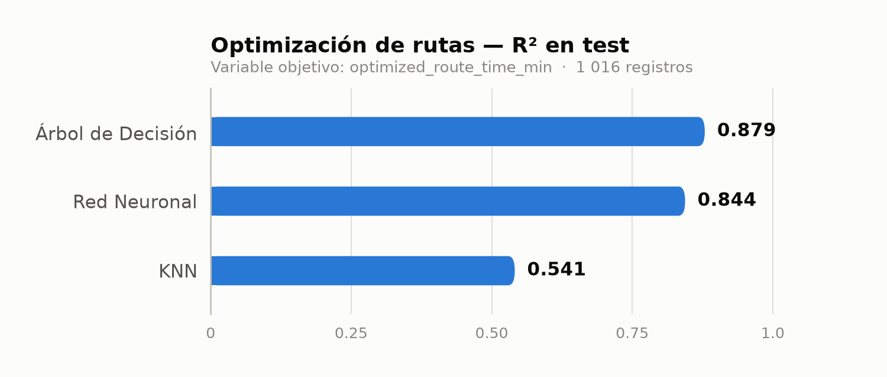
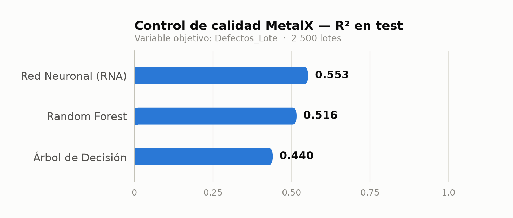

<div align="center">

**English** · [Español](README.es.md)

# Machine Learning Applied to Industrial Processes

**Academic Industrial Engineering projects — Universidad Peruana de Ciencias Aplicadas (UPC)**

Data analytics, advanced statistics and predictive models applied to
real logistics and manufacturing problems.

<br>


<br>

[](https://fcarruitero24.github.io/UPC_projects_exams/)

**[fcarruitero24.github.io/UPC_projects_exams](https://fcarruitero24.github.io/UPC_projects_exams/)**

It includes a **batch simulator**: you move the machine's four sensors and the
trained Random Forest responds instantly, with no server, because the model
(100 trees, 56 KB) runs in the browser.

</div>

---

## The projects

| # | Project | Problem | Best model | Metric |
|:--:|---|---|---|:--:|
| **01** | [E-commerce route optimization](01-optimizacion-rutas-ecommerce/) | Predict the optimized route time from logistics variables | Decision Tree | **R² = 0.879** |
| **02** | [Quality control — MetalX case](02-control-calidad-metalx/) | Predict defective parts per batch in plastic injection molding | Neural Network (ANN) | **R² = 0.553** |

Both follow the same workflow: EDA → data quality audit → cleaning →
feature engineering → training 3 models → 5-fold cross-validation →
comparison and prediction on a new case.

---

## 01 · E-commerce route optimization

Audit and modeling of a deliberately "dirty" logistics dataset
(1,030 records, 18 columns). The goal is to predict
`optimized_route_time_min` to support decisions about delivery windows,
distances and costs.

<div align="center">
<picture>
  <source media="(prefers-color-scheme: dark)" srcset="01-optimizacion-rutas-ecommerce/assets/comparativa-modelos-dark.png">
  
</picture>
</div>

| Model | MAE | RMSE | R² | Cross-validation R² |
|---|:--:|:--:|:--:|:--:|
| **Decision Tree** *(GridSearchCV, `max_depth=5`)* | **15.06** | **24.30** | **0.879** | 0.856 |
| Neural Network (Keras) | 18.90 | 27.57 | 0.844 | — |
| KNN *(`k=7`)* | 28.28 | 47.28 | 0.541 | 0.616 |

**A critical reading of the result.** Two variables account for **99.1%** of the
tree's importance: `average_speed_kmph` (50.3%) and `distance_km` (48.8%).
This is no accident: the model is reconstructing the physical relationship
*time = distance / speed*, which explains such a high R² with so few
relevant variables. It is a valid result as a modeling exercise, but in
production it would indicate that **the remaining 14 variables add no
predictive information** and that the real problem needs a target variable
that is less determined by its own predictors.

→ [See project details (in Spanish)](01-optimizacion-rutas-ecommerce/)

---

## 02 · Predictive quality control — MetalX case

Prediction of the number of defective parts per batch (`Defectos_Lote`) in a
plastic injection molding process, from 4 machine variables measured in
real time across 2,500 batches.

<div align="center">
<picture>
  <source media="(prefers-color-scheme: dark)" srcset="02-control-calidad-metalx/assets/comparativa-modelos-dark.png">
  
</picture>
</div>

| Model | MAE | MSE | R² |
|---|:--:|:--:|:--:|
| **Neural Network (ANN)** *(16→8→1, ReLU)* | **9.80** | **240.1** | **0.553** |
| Random Forest *(GridSearchCV)* | 10.18 | 260.0 | 0.516 |
| Decision Tree *(GridSearchCV)* | 10.87 | 300.7 | 0.440 |

**The key finding.** The machine's **RMS vibration accounts for 89.3% of the
predictive importance** (correlation of 0.57 with defects), far above mold
temperature (7.5%), injection pressure (2.4%) and cycle time (0.8%). In plant
terms: **monitoring vibration is the most cost-effective quality-control lever**
in the process, and it justifies prioritizing predictive maintenance over
tuning the other parameters.

The R² ceiling of ≈ 0.55 is explained by the strong skew of the target variable
(*skewness* = 4.65; median of 34.9 defects versus a maximum of 533): atypical
batches are hard to anticipate with only four sensors.

→ [See project details (in Spanish)](02-control-calidad-metalx/)

---

## Tech stack

| Area | Tools |
|---|---|
| Data manipulation | `pandas`, `numpy` |
| Visualization | `matplotlib`, `seaborn` |
| Statistics | `scipy.stats` (Kolmogorov-Smirnov, Spearman, IQR) |
| Machine learning | `scikit-learn` (Decision Tree, Random Forest, KNN, GridSearchCV, K-Fold) |
| Deep learning | `tensorflow` / `keras` (dense networks) |

---

## Repository structure

```
UPC_projects_exams/
├── 01-optimizacion-rutas-ecommerce/
│   ├── assets/                                  # exported charts
│   ├── dirty_ecommerce_logistics_route_planning_dataset.csv
│   ├── optimizacion_rutas_ecommerce.ipynb
│   └── README.md
├── 02-control-calidad-metalx/
│   ├── assets/
│   ├── control_calidad_metalx.ipynb
│   ├── control_calidad_metalx.py                # same analysis as a script
│   ├── df_metalx.csv
│   └── README.md
├── docs/
│   ├── index.html                               # dashboard published on GitHub Pages
│   └── src/
│       ├── build.py                             # regenerates index.html from the data
│       └── template.html                        # template without the injected data
├── requirements.txt
├── LICENSE
└── README.md
```

### Regenerating the dashboard

The dashboard is not edited by hand: `index.html` is generated by retraining the
models and serializing the Random Forest into the template.

```bash
python docs/src/build.py
```

---

## How to run it

```bash
git clone https://github.com/fcarruitero24/UPC_projects_exams.git
cd UPC_projects_exams

python -m venv .venv
source .venv/bin/activate        # on Windows: .venv\Scripts\activate

pip install -r requirements.txt
jupyter notebook
```

> [!NOTE]
> The notebooks load the datasets by relative path, so they must be run
> from their own project folder. The notebooks already include all outputs
> and charts: they can be read on GitHub without running anything.

---

## Author

**Fabrizio Carruitero** — Industrial Engineering, UPC
Data and machine learning applied to industrial processes

[](https://github.com/fcarruitero24)

<sub>Distributed under the MIT license. The datasets are for academic use.</sub>
